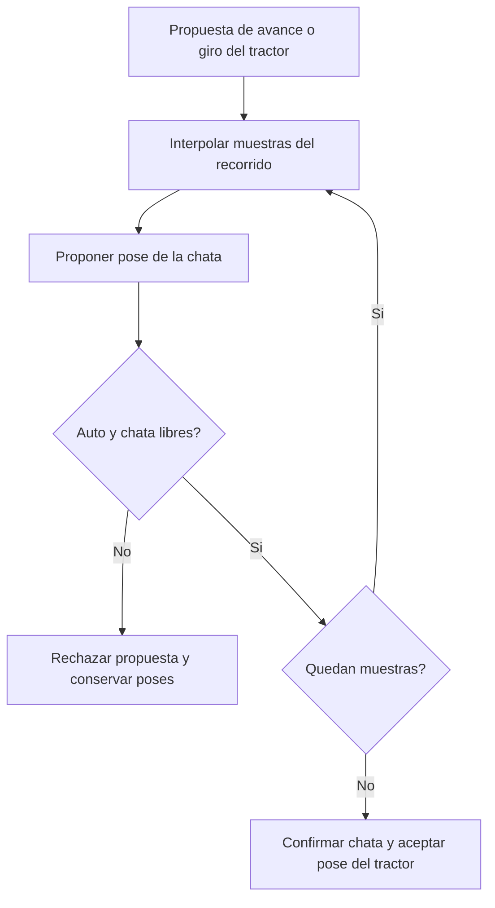

# CiudadConduccion — Documentación funcional y técnica

**Fecha de revisión:** 17 de octubre de 2026, zona horaria America/La_Paz.  
**Versión descrita:** ciudad ampliada, contrarreloj, derrape, turbo, tráfico autónomo, pasos de cebra corregidos, peatones, puntuación y chata articulada.  
**Aplicación principal:** `com.graphics.clase4`.  
**Tecnologías:** Java 17 como versión objetivo, Maven, LWJGL 3.3.3 y OpenGL 3.3 Core.  
**Configuración actual de la chata:** `DISTANCIA_EJE = 3f`; plataforma con huella de 2 × 2.4 unidades.

Este documento describe el código guardado en `src`, sus controles, algoritmos y límites. Los enlaces a archivos son relativos a la carpeta Maven, por lo que siguen funcionando al trasladar el proyecto.

**Estado de verificación:** la compilación limpia del 17 de octubre ejecutó 65 pruebas: 60 aprobadas, 5 fallos de aserción y ningún error de ejecución. Los cinco casos conservan posiciones o expectativas de la lanza anterior de 2.1 unidades. La [sección 12](#12-pruebas-y-evidencia) identifica cada caso y separa este resultado de las capturas históricas. La revisión documental conserva la configuración de 3 unidades y no modifica la lógica Java ni los escenarios de prueba.

## Contenido

1. [Alcance y estado actual](#1-alcance-y-estado-actual)
2. [Requisitos y puesta en marcha](#2-requisitos-y-puesta-en-marcha)
3. [Manual del jugador](#3-manual-del-jugador)
4. [Arquitectura y ciclo del programa](#4-arquitectura-y-ciclo-del-programa)
5. [Ciudad y pasos de cebra](#5-ciudad-y-pasos-de-cebra)
6. [Movimiento, derrape y turbo](#6-movimiento-derrape-y-turbo)
7. [Sistema de colisiones](#7-sistema-de-colisiones)
8. [Autos NPC](#8-autos-npc)
9. [Peatones y puntos negativos](#9-peatones-y-puntos-negativos)
10. [Chata articulada](#10-chata-articulada)
11. [Dibujo, luces e interfaz](#11-dibujo-luces-e-interfaz)
12. [Pruebas y evidencia](#12-pruebas-y-evidencia)
13. [Personalizar y recompilar](#13-personalizar-y-recompilar)
14. [Limitaciones, pendientes y entrega](#14-limitaciones-pendientes-y-entrega)

## 1. Alcance y estado actual

El proyecto es un escenario de conducción interactivo construido con geometría generada por código. El jugador conduce un automóvil con remolque por una ciudad, evita obstáculos y actores móviles y trata de llegar a una meta en el menor tiempo posible. Los atropellos producen una puntuación negativa independiente del tiempo.

| Elemento | Implementación actual |
|---|---|
| Ciudad | Matriz de 11 × 11 celdas; mundo de 110 × 110 unidades |
| Parcelas | 96 celdas de calle, 21 edificios y 4 parques |
| Equipamiento | 25 farolas, 25 semáforos, 16 árboles y 4 bancos |
| Pasos de cebra | 80 cruces entre aceras enfrentadas; 10 franjas por cruce |
| Jugador | Un auto controlable con derrape, turbo y una chata articulada |
| Tráfico | Tres autos NPC con circuitos cerrados |
| Peatones | Cuatro bots provisionales que cruzan por cebras seleccionadas |
| Obstáculos | Tres barreras fijas, además de aceras y bordes |
| Misión | Salida A, meta B, cronómetro y mejor tiempo de la sesión |
| Puntuación | Empieza en cero; resta 100 por incidente de atropello |
| Vistas | Cámara de seguimiento, cámara general y minimapa |

La ampliación conserva el núcleo original de 7 × 7, incorporándolo a una ciudad mayor. Las mejoras posteriores añadieron colisiones orientadas, misión, derrape y turbo, tráfico, cebras alineadas, peatones y puntuación. La chata se incorporó en una clase independiente y su distancia de enganche a eje se ajustó posteriormente de 2.1 a **3 unidades**.

No existe una secuencia de checkpoints, un sistema de carga del remolque ni una misión de reparto. Los semáforos son decorativos y los actores autónomos siguen reglas y rutas programadas.

## 2. Requisitos y puesta en marcha

### 2.1 Requisitos

- JDK 17 o superior. El proyecto compila con `maven.compiler.release = 17`.
- Maven disponible en la terminal.
- Sesión de escritorio y controlador gráfico compatibles con OpenGL 3.3 Core.
- Dependencias de [pom.xml](pom.xml) disponibles en la caché Maven o acceso a su descarga durante la primera compilación.

La comprobación de esta revisión utilizó Windows 11 x64, JDK 24.0.2 y Maven 3.9.16. El POM incluye bibliotecas nativas para Windows x64, macOS Intel/Apple Silicon y Linux x64/ARM64. Esa declaración no demuestra por sí sola que se haya probado cada plataforma. El perfil de macOS añade `-XstartOnFirstThread` para GLFW.

### 2.2 Iniciar el juego

La carpeta Maven es la **interior**, donde se encuentra `pom.xml`:

```powershell
cd "C:\program grafica\CiudadConduccion\CiudadConduccion"
mvn compile exec:exec
```

El comando compila y ejecuta `com.graphics.clase4`. ESC o el botón de cierre terminan el programa. Si se trasladó el proyecto, se debe usar la nueva carpeta que contiene el POM.

Después de cambiar constantes o si se observa una versión anterior, guardar los archivos, cerrar el juego y recompilar desde cero:

```powershell
mvn clean compile exec:exec
```

`clean` elimina `target`, incluidas sus capturas e informes. Si se desea conservarlos, copiarlos previamente fuera de esa carpeta. La tecla R reinicia variables de la partida, pero no recompila ni recarga clases Java.

### 2.3 Ejecutar las etapas didácticas

```powershell
mvn compile exec:exec '-DmainClass=com.graphics.clase1'
mvn compile exec:exec '-DmainClass=com.graphics.clase2'
mvn compile exec:exec '-DmainClass=com.graphics.clase3'
```

`clase1` presenta ciudad y cámara; `clase2` añade conducción; `clase3` añade iluminación. El tráfico, peatones, misión, puntuación, chata, decoración ampliada y minimapa se integran en `clase4`.

Para comprobar únicamente un arranque breve de la aplicación principal:

```powershell
mvn compile exec:exec '-Ddemo.frames=6'
```

## 3. Manual del jugador

### 3.1 Controles

| Tecla | Acción |
|---|---|
| W / flecha arriba | Acelerar hacia delante |
| S / flecha abajo | Reducir el avance y entrar en reversa |
| A / D o flechas izquierda / derecha | Girar mientras el auto tiene movimiento |
| Espacio + dirección | Freno de mano y derrape si hay velocidad suficiente |
| Espacio sin giro | Frenar; si persiste deriva puede mantenerse brevemente el derrape |
| Ctrl izquierdo o derecho | Freno fuerte |
| Shift izquierdo o derecho | Activar un turbo disponible, una vez por pulsación |
| C | Alternar cámara de seguimiento y vista general |
| N | Alternar día y noche |
| F | Encender o apagar los dos faros delanteros |
| M | Mostrar u ocultar el minimapa |
| R | Reiniciar auto, chata, tráfico, peatones, puntos, misión y semáforos |
| ESC | Salir |

En `clase1`, izquierda y derecha orbitan la cámara. Desde `clase2`, esas teclas se usan para conducir. La aplicación completa comienza de noche, con faros y minimapa encendidos, y con cámara de seguimiento.

### 3.2 Misión contrarreloj

La salida está en **(−30, 30)** y el auto comienza orientado hacia −Z, el norte del minimapa. La meta está en **(50, −50)** y se identifica por una base dorada a cuadros y una baliza flotante.

Los estados de [Contrarreloj.java](src/main/java/com/graphics/Contrarreloj.java) son:

| Estado | Comportamiento |
|---|---|
| `LISTO` | El tiempo permanece en cero hasta un desplazamiento real del auto |
| `EN_CURSO` | Se acumula tiempo real; esperar o chocar también cuenta |
| `COMPLETADO` | Se congela el resultado y se actualiza el menor tiempo de la sesión |

La llegada se activa cuando el **centro del auto** entra en un radio de 3 unidades de la meta. No exige detenerse, tener puntos no negativos ni introducir toda la chata en la zona. Tras completar la misión se puede seguir conduciendo y recibiendo penalizaciones.

R prepara un nuevo intento y conserva el mejor tiempo. Cerrar el programa borra el récord. R mantiene las preferencias actuales de cámara, iluminación, faros y minimapa.

### 3.3 Indicadores y maniobras con chata

El panel inferior presenta estado de misión, tiempo, récord, puntos, atropellos, aviso temporal, turbo y derrape. El título de la ventana añade velocidad en km/h e interruptores de cámara, luces y mapa.

| Color o forma del minimapa | Significado |
|---|---|
| Verde intenso | Salida |
| Dorado a cuadros | Meta |
| Cian con punta blanca | Auto del jugador y su frente |
| Plataforma dorada unida al jugador | Chata |
| Naranja | Barreras |
| Azul, violeta y blanco con punta | Autos NPC |
| Amarillo/anaranjado | Peatones |
| Rojo en el marcador peatonal | Peatón durante recuperación tras un impacto |

La chata requiere más espacio para girar y retroceder. Puede bloquear una maniobra aunque el auto tenga espacio. Si el contacto permite alejarse, avanzar en la dirección libre libera el conjunto; insistir hacia el obstáculo no lo atraviesa.

## 4. Arquitectura y ciclo del programa

### 4.1 Clases y responsabilidades

Las once clases principales están en `src/main/java/com/graphics`:

| Archivo | Responsabilidad y métodos de referencia |
|---|---|
| [clase1.java](src/main/java/com/graphics/clase1.java) | Ventana, ciclo, mapa, cubo reutilizable, cámara general y shaders base: `run`, `escena`, `configurarCamara`, `cajaGirada` |
| [clase2.java](src/main/java/com/graphics/clase2.java) | Entrada de conducción, movimiento, derrape, turbo, huella del auto y seguimiento: `actualizar`, `moverAuto`, `intentarMoverJugador` |
| [clase3.java](src/main/java/com/graphics/clase3.java) | Iluminación y farolas: `crearLuces`, `prepararLuces`, `fragmentShader` |
| [clase4.java](src/main/java/com/graphics/clase4.java) | Integra misión, barreras, tráfico, peatones, puntuación, chata, decoración y minimapa |
| [Contrarreloj.java](src/main/java/com/graphics/Contrarreloj.java) | Estado de misión, tiempo y récord, sin dependencia de OpenGL |
| [PanelCarrera.java](src/main/java/com/graphics/PanelCarrera.java) | Rasteriza texto con Java AWT y lo presenta como textura OpenGL |
| [VehiculoNpc.java](src/main/java/com/graphics/VehiculoNpc.java) | Circuito, velocidad, progreso y pose de cada conductor autónomo |
| [PasoPeatonal.java](src/main/java/com/graphics/PasoPeatonal.java) | Geometría compartida entre cebras y rutas de peatones |
| [PeatonNpc.java](src/main/java/com/graphics/PeatonNpc.java) | Desplazamiento, espera, impacto, recuperación y colisión circular |
| [PuntuacionConduccion.java](src/main/java/com/graphics/PuntuacionConduccion.java) | Contador de atropellos y cálculo de puntos negativos |
| [ChataRemolque.java](src/main/java/com/graphics/ChataRemolque.java) | Pose y seguimiento articulado, huellas y dibujo del remolque |

La herencia acumulativa es:

```text
clase1: ciudad y recursos OpenGL
   └── clase2: conducción y auto
          └── clase3: iluminación
                 └── clase4: juego completo
```

Las clases auxiliares separan responsabilidades y permiten comprobar la lógica sin abrir una ventana. Los registros `Posicion`, `Punto`, `Franja` y `Huella` agrupan datos de geometría y evitan modificar accidentalmente una pose consultada.

### 4.2 Ciclo de ejecución

`clase1.run()` crea GLFW, la ventana, el contexto OpenGL, shaders y buffers. Después ejecuta el ciclo hasta recibir una solicitud de cierre y libera los recursos mediante `finally`.

En cada cuadro del juego completo:

1. GLFW procesa eventos y se mide `deltaTime` con `glfwGetTime()`.
2. Se actualizan el reloj de animación y el aviso de atropello.
3. La conducción heredada propone movimientos del jugador y valida la chata.
4. Se actualizan autos NPC, después peatones y después la misión.
5. Se actualiza el título y se consulta el tamaño real del framebuffer.
6. Se dibujan la escena principal, el minimapa y el panel si hay espacio útil.
7. Se intercambian buffers.

La minimización puede impedir el dibujo, pero el tiempo de la misión se sigue calculando. Las teclas de alternancia responden a `GLFW_PRESS`; las de conducción se consultan como entradas sostenidas.

## 5. Ciudad y pasos de cebra

### 5.1 Matriz y coordenadas

`MAPA` usa `0` para calle, `1` para edificio y `2` para parque. X corresponde a columnas, Z a filas y Y a altura. Cada celda mide 10 × 10 unidades. Su centro se obtiene con:

```text
centro(indice) = -LIMITE + CELDA × (indice + 0.5)
LIMITE = 55; CELDA = 10
```

Los centros abarcan de −50 a 50 y el suelo llega a ±55. El núcleo original se conserva en los índices 2 a 8. Las filas y columnas pares forman la red vial del mapa actual.

Las aceras ocupan la parcela completa de 10 × 10. Los edificios tienen planta de 7 × 7 y altura determinista de 5 a 13. Cada parque tiene cuatro árboles y un banco. Para conducción, la parcela completa es un obstáculo: no se puede entrar a un parque ni usar su interior como atajo.

### 5.2 Barreras

Las posiciones y semidimensiones están en `clase4.OBSTACULOS`, compartidas por dibujo y colisión:

| Centro X | Centro Z | Semiancho X | Semilargo Z |
|---:|---:|---:|---:|
| −31.6 | 10 | 1.2 | 1.5 |
| 8 | −31.6 | 1.5 | 1.2 |
| 48.4 | −10 | 1.2 | 1.5 |

Cada barrera deja espacio lateral para el vehículo, pero una trayectoria con remolque debe considerar también su longitud y articulación.

### 5.3 Corrección de las cebras

La pintura anterior se dibujaba con un desplazamiento fijo junto a cada manzana y no cubría correctamente la calle. Ahora `PasoPeatonal.generar()` busca **aceras enfrentadas con una celda de calle entre ellas**. Genera dos pasos cerca de las esquinas de cada tramo apto, desplazados ±3.5 unidades respecto a su centro.

Con el mapa actual se obtienen 80 cruces: 40 para cruzar X y 40 para cruzar Z. Cada uno tiene 10 unidades de longitud, 2.4 de ancho y diez franjas de 0.55 de grosor separadas a intervalos de una unidad. Las franjas quedan paralelas al tráfico y se distribuyen de un lado al otro de la calzada.

`dibujarMarcasCalle()` interrumpe las marcas amarillas cerca de las cebras. No se generan cruces hacia un borde exterior sin acera de llegada. La ruta de un peatón usa la misma geometría: sus extremos están a ±5.6 del centro, es decir, 0.6 unidades dentro de cada acera. Solo cuatro de las 80 cebras tienen bots activos.

## 6. Movimiento, derrape y turbo

### 6.1 Integración temporal

`clase2.actualizar()` traduce el teclado a acelerador, dirección y frenos. Simula como máximo **0.05 segundos de movimiento por cuadro**, divididos en pasos de hasta **1/120 s**. NPC y peatones emplean el mismo límite temporal.

Esto evita grandes saltos tras una pausa. No representa una simulación que recupere todo el tiempo perdido: por debajo de 20 FPS el avance puede ralentizarse respecto al tiempo real. El cronómetro, la espera del turbo, la duración de las marcas y el aviso del panel siguen consumiendo tiempo real; la recuperación del peatón usa tiempo simulado.

### 6.2 Aceleración y dirección

`moverAuto()` aplica aceleración y resistencia exponencial:

```text
velocidad += aceleracion × dt
velocidad *= exp(-resistencia × dt)
giro = direccion × velocidad × coeficienteGiro × dt
```

| Parámetro | Valor |
|---|---:|
| Aceleración normal | `acelerador × 9` |
| Aceleración con turbo | 32 |
| Límite nominal de avance | 16 unidades/s |
| Límite de reversa | −6 unidades/s |
| Límite con turbo | 28 unidades/s |
| Resistencia normal / turbo | 0.7 / 0.3 |
| Resistencia en derrape / frenado fuerte | 1 / 7 |
| Coeficiente de giro normal / derrape | 0.11 / 0.18 |

Son parámetros de una conducción simplificada. El límite nominal no garantiza alcanzar 16 unidades/s, porque la resistencia también influye. Al acabar el turbo, la velocidad por encima del límite normal disminuye gradualmente.

### 6.3 Derrape

Se activa con Espacio, sin Ctrl, velocidad positiva mayor que 3 y una orden de giro o un desfase todavía apreciable. No es obligatorio mantener W si ya existe velocidad suficiente.

`angulo` indica hacia dónde apunta la carrocería. `desfaseDerrape` representa cuánto difiere la dirección de desplazamiento. Al aceptar un giro, se descuenta ese giro del desfase para conservar parte de la dirección previa del movimiento:

```text
direccionMovimiento = angulo + desfaseDerrape
frenteX = -sin(direccionMovimiento)
frenteZ = -cos(direccionMovimiento)
```

El desfase se reduce con `exp(-1.2 × dt)` durante el derrape y con `exp(-7 × dt)` al recuperar agarre. Se limita a ±1.05 radianes y se anula cuando es insignificante o el auto casi se detiene. La chata sigue el desplazamiento resultante del enganche.

Cada 0.06 segundos de derrape se generan dos marcas de ruedas. Duran seis segundos y se conservan como máximo 160. Son un efecto visual y no alteran la adherencia del suelo.

### 6.4 Turbo

`activarTurbo()` concede un segundo de impulso cuando no hay turbo activo ni espera pendiente y la velocidad no es negativa. Mantener Shift no lo repite: hace falta otra pulsación. Tras terminar comienza una espera de dos segundos.

Ctrl o solicitar reversa cancela el impulso y aplica esa espera. `actualizarTurbo()` consume también el tiempo real que exceda los 50 ms físicos, de modo que un cuadro lento no prolonga el impulso. R vuelve a dejarlo disponible.

## 7. Sistema de colisiones

Todas las colisiones de conducción son **planas sobre X/Z**. Se usa la misma posición y orientación que en el dibujo; la altura no interviene en la detección.

| Elemento | Representación |
|---|---|
| Auto del jugador y autos NPC | Rectángulo orientado de 2 × 2.72 unidades |
| Aceras y barreras | Rectángulos alineados con los ejes de la ciudad |
| Peatón | Círculo de radio 0.32 |
| Plataforma de la chata | Rectángulo orientado de 2 × 2.4 |
| Lanza de la chata | Rectángulo orientado de 0.18 × 3 |

### 7.1 Detección geométrica

`colisionRectangulo()` aplica el teorema de ejes separadores: si las proyecciones no se solapan en alguno de los cuatro ejes considerados, las huellas están separadas. `colisionVehiculos()` transforma una carrocería al espacio local de la otra para reutilizar la comprobación. `ChataRemolque.Huella.colision()` realiza el mismo principio para rectángulos de distintas dimensiones.

La colisión peatonal transforma el centro del círculo al espacio local del rectángulo, encuentra la distancia a su punto más cercano y la compara con el radio. Así no se bloquean las esquinas vacías de una caja que envolviera al peatón.

### 7.2 Consultas y movimientos aceptados

| Método | Uso |
|---|---|
| `puedeCircularSinTrafico()` | Comprueba la huella del auto contra límites, aceras y barreras |
| `puedeCircular()` | Consulta del auto contra geometría fija, vehículos y peatones, sin puntuar |
| `puedeMoverJugador()` | Comprueba una propuesta real del auto y registra contactos peatonales |
| `intentarMoverJugador()` | Valida una maniobra del tractor junto a la propuesta de su chata |
| `chataLibreDeObstaculos()` | Consulta pura de articulación, tractor propio, límites, aceras, barreras y NPC |

`puedeCircular()` por sí solo **no representa al conjunto completo**. La validación de chata se integra en `intentarMoverJugador()`.

La conducción intenta primero el giro y después el desplazamiento. Si este último falla, prueba las componentes X y Z por separado para permitir deslizar junto a un obstáculo. Si ninguna queda libre, pone a cero velocidad y deriva. Un giro rechazado puede ir seguido de un avance recto válido.

Para cada propuesta, `clase4` interpola muestras del **tractor** separadas como máximo por 0.08 unidades de desplazamiento o 0.02 radianes de giro. En cada una propone el seguimiento de la chata y comprueba las huellas. Es una aproximación discreta del espacio recorrido, no una detección continua exacta.

Si una muestra falla, no se confirma ninguna pose parcial de esa propuesta. Una penalización por el contacto detectado sí puede registrarse, aunque se rechace el avance. Si todas pasan, se confirma la chata y la conducción acepta inmediatamente la pose correspondiente del auto.

## 8. Autos NPC

`clase4.trafico` crea tres instancias de `VehiculoNpc`:

| Color | Límite del circuito X/Z | Velocidad de crucero | Distancia inicial sobre la ruta |
|---|---:|---:|---:|
| Azul | ±52 | 7 unidades/s | 180 |
| Violeta | ±28 | 6 unidades/s | 180 |
| Blanco | ±12 | 5 unidades/s | 0 |

Cada circuito tiene cuatro rectas y cuatro curvas de 90° con radio 3. `posicionEn()` convierte la distancia recorrida en coordenadas y orientación tangente: calcula un tramo recto o circular y lo rota según el lado del circuito. La distancia se repite mediante módulo al terminar cada vuelta.

`actualizar()` acelera a razón de 3 unidades/s² hasta la velocidad de crucero. Comprueba tanto la posición siguiente como una posición adelantada a `distancia + 2 + velocidadPropuesta × 0.6`. Si cualquiera está ocupada, se detiene inmediatamente.

`clase4.actualizarTrafico()` consulta aceras, barreras, jugador, chata, otros NPC y peatones. El conductor espera y reanuda cuando el espacio queda libre. No planifica otro camino, no cambia de carril ni obedece semáforos.

El modelo visual se comparte con el jugador mediante `dibujarVehiculo()`. Los NPC no tienen chata ni focos dinámicos propios. R restablece su progreso inicial y velocidad cero.

## 9. Peatones y puntos negativos

### 9.1 Rutas y estados del peatón

`crearPeatones()` selecciona cuatro cruces existentes:

| Centro del cruce | Eje que recorre el peatón |
|---|---|
| (10, −16.5) | X |
| (10, 3.5) | X |
| (−16.5, −10) | Z |
| (23.5, −10) | Z |

Cada bot empieza en el extremo negativo de su ruta, espera un segundo y camina a 1.4 unidades/s. Al alcanzar el otro extremo cambia de sentido y espera dos segundos. Recorre 11.2 unidades entre los extremos sobre las aceras.

`actualizarPeatones()` comprueba auto, plataforma y lanza de la chata, NPC y otros peatones. Si la posición siguiente está ocupada, el bot espera. Entre peatones se exige la separación correspondiente a la suma de radios: 0.64 unidades.

Tras un impacto, `registrarImpacto()` marca al peatón y fija tres segundos de recuperación simulada. Permanece detenido, se muestra rojo y sigue teniendo colisión. Cuando termina ese tiempo, vuelve al extremo inicial si está libre; si no, espera. Al reaparecer recupera también su espera inicial.

Los personajes son modelos provisionales de cajas: cuerpo, cabeza y piernas, sin animación de caminata. No tienen navegación general por aceras ni decisiones relacionadas con semáforos.

### 9.2 Registro de atropellos

El auto y la chata utilizan `registrarContactoPeaton()`. Se registra un incidente cuando hay una propuesta real de desplazamiento o giro que toca al peatón, la magnitud de velocidad supera 0.01 y `registrarImpacto()` devuelve `true`.

El método devuelve `false` si ese peatón ya está impactado. Esto impide que el mismo contacto descuente puntos en cada cuadro. Tras recuperarse puede registrarse un nuevo incidente. Una consulta de ruta o un auto estacionado no produce penalización.

### 9.3 Cálculo y presentación de puntos

`PuntuacionConduccion` conserva el número de atropellos:

```java
public static final int PENALIZACION_ATROPELLO = 100;

public void registrarAtropello() { atropellos++; }
public int puntos() { return -atropellos * PENALIZACION_ATROPELLO; }
```

Cero incidentes producen 0 puntos; uno, −100; dos, −200. La misma regla se aplica en reversa, con turbo o al contactar mediante la chata. El aviso del panel dura tres segundos reales.

Los puntos no modifican el tiempo ni la mejor marca. Derrapar y chocar contra objetos o autos NPC no restan puntos actualmente. La puntuación continúa activa después de llegar a la meta y R la devuelve a cero.

## 10. Chata articulada

### 10.1 Clase independiente y parámetros actuales

`clase4` crea una única `ChataRemolque`, exclusiva del auto principal. Su dibujo incluye chasis, siete tablas de madera, dos ruedas, barandas, compuerta baja, luces traseras y lanza metálica. El eje está centrado en la plataforma.

| Constante | Valor actual | Significado |
|---|---:|---|
| `ENGANCHE_AUTO` | 1.5 | Centro del auto → rótula trasera |
| `DISTANCIA_EJE` | **3** | Rótula → eje de ruedas de la chata |
| `MITAD_ANCHO` | 1 | Semiancho de colisión de plataforma, incluidas ruedas |
| `MITAD_LARGO` | 1.2 | Semilargo de colisión, incluidas luces |
| `ARTICULACION_MAXIMA` | 70° | Diferencia angular máxima respecto al tractor |

Con el conjunto alineado, los centros están separados **4.5 unidades**. En la salida, el auto está en (−30, 30) y el eje de la chata en (−30, 34.5). La cola de su huella llega a Z = 35.7, dentro de la calle vertical de salida.

`DISTANCIA_EJE` no representa únicamente la barra visible delante de la plataforma: parte de la lanza queda debajo del piso. Con las dimensiones actuales, el tramo exterior mide aproximadamente 1.8 unidades respecto al borde de colisión de la plataforma, o 1.85 respecto al borde del chasis dibujado.

### 10.2 Cómo sigue al auto

`Posicion` guarda X, Z y ángulo del eje. En cada propuesta se calcula el nuevo enganche H a partir del tractor, y después la dirección hacia el eje anterior:

```text
Hx = autoX + sin(anguloAuto) × ENGANCHE_AUTO
Hz = autoZ + cos(anguloAuto) × ENGANCHE_AUTO

anguloChata = atan2(ejeAnteriorX - Hx, ejeAnteriorZ - Hz)
ejePropuestoX = Hx + sin(anguloChata) × DISTANCIA_EJE
ejePropuestoZ = Hz + cos(anguloChata) × DISTANCIA_EJE
```

La proyección mantiene la longitud fija del enganche al eje y aproxima un eje sin desplazamiento lateral en pasos pequeños. Si el vector utilizado es prácticamente nulo, conserva la orientación anterior.

El auto tira de la chata al avanzar y la empuja en reversa. La chata sigue el desplazamiento real del enganche, incluido el derrape, y conserva un ángulo propio. No tiene otro motor ni copia directamente la orientación del auto.

### 10.3 Proponer, comprobar y confirmar



`proponer()` devuelve una pose sin modificar la aceptada. `chataLibreDeObstaculos()` comprueba el límite de articulación y ambas huellas contra el tractor, bordes, parcelas, barreras y autos NPC. También se consultan peatones antes de aceptar la maniobra.

`confirmar()` se invoca únicamente cuando todas las muestras son válidas. Un choque exclusivo de la chata puede bloquear al tractor; no se fuerza el remolque a atravesar el obstáculo ni se lo recoloca para enderezarlo.

`reiniciar()` alinea el conjunto al pulsar R. `colocarJugador()` sirve para preparar escenas y pruebas con ambas partes alineadas; no forma parte del seguimiento normal durante la conducción.

### 10.4 Alcance físico

Es un modelo **cinemático sobre suelo plano**. Representa enganche, seguimiento, articulación, colisiones y bloqueo. No calcula masa de carga, suspensión, fuerzas de neumáticos, vuelcos ni inercia independiente del remolque. Alargar la chata no reduce automáticamente la aceleración del tractor, aunque sí altera su espacio de maniobra.

## 11. Dibujo, luces e interfaz

### 11.1 Geometría y recursos OpenGL

La escena reutiliza un cubo almacenado en VAO/VBO. `caja()` y `cajaGirada()` posicionan, escalan y orientan las piezas. Los shaders están incorporados como texto Java y reciben parámetros mediante uniforms. No se requieren modelos o texturas externos para edificios, vehículos, peatones o chata.

La limpieza libera programas, buffers, VAO, recursos del panel, callbacks y ventana. La profundidad permite que objetos cercanos oculten superficies lejanas.

### 11.2 Iluminación y semáforos

El shader de `clase3` combina luz ambiental, luz direccional y contribuciones difusas locales con normales y atenuación. Las 25 farolas aportan luz de noche; su alcance se desvanece entre 14 y 22 unidades. Los dos faros del jugador siguen su posición y orientación y se desvanecen entre 18 y 28 unidades; pueden encenderse también de día.

`uEmision` permite mostrar un color propio sin oscurecerlo, como en ventanas nocturnas o señalización. No convierte automáticamente esas superficies en luces que iluminen otros objetos. No hay sombras ni oclusión de luz por paredes.

Los 25 semáforos comparten un ciclo sincronizado de 12 segundos: rojo durante 5, verde durante 5 y amarillo durante 2. R reinicia ese reloj. Son decorativos para jugador, peatones y NPC.

### 11.3 Cámaras, minimapa y panel

La cámara de seguimiento se sitúa 12 unidades detrás del auto y a altura 9. La cámara general ajusta su distancia al tamaño de la ciudad y a la proporción de la ventana. El plano lejano acompaña ese encuadre.

El minimapa vuelve a dibujar la escena con proyección ortográfica, norte arriba y extensión ±57. Se ubica arriba a la derecha; su lado es `min(260, min(ancho, alto)/3)`. Usa `glScissor` para limitar la limpieza y `glViewport` para delimitar la vista. Un bloque `finally` restaura proyección, viewport y recorte.

Se omite el minimapa si la dimensión menor de ventana es inferior a 60 píxeles. El panel requiere al menos 240 × 180. `PanelCarrera` mide y rasteriza texto con Java AWT, lo sube a una textura y la actualiza cuando cambia el contenido o el ancho. También restaura los estados de OpenGL que utiliza.

## 12. Pruebas y evidencia

### 12.1 Resultado de esta revisión

El 17 de octubre de 2026, a las 20:11 de Bolivia, se ejecutó:

```powershell
mvn clean test
```

Se recompilaron once archivos principales y ocho archivos de prueba/verificación. **Resultado: 65 pruebas ejecutadas, 60 aprobadas, 5 fallos de aserción, 0 errores y 0 omitidas.** Maven terminó con `BUILD FAILURE` por esas cinco aserciones. La compilación Java sí terminó correctamente.

| Conjunto | Ejecutadas | Aprobadas | Fallos | Cobertura prevista |
|---|---:|---:|---:|---|
| `CiudadAmpliadaTest` | 14 | 14 | 0 | Mapa, núcleo, conectividad, cámaras, luces y conducción |
| `ConduccionTest` | 3 | 3 | 0 | Movimiento básico, colisiones y reinicio |
| `DerrapeTurboTest` | 10 | 10 | 0 | Impulso, espera, agarre, deriva, colisiones y FPS |
| `MisionYColisionesTest` | 9 | 8 | 1 | Esquinas, barreras, reversa, tiempos y llegada |
| `TraficoTest` | 8 | 8 | 0 | Circuitos, espera, huellas, reinicio y encuentros con jugador |
| `PeatonesTest` | 9 | 9 | 0 | Cebras, contactos, penalización, recuperación y prioridad |
| `ChataRemolqueTest` | 12 | 8 | 4 | Enganche, articulación, maniobras y colisiones propias |
| **Total** | **65** | **60** | **5** | **Configuración actual con lanza de 3 unidades** |

Los informes de la ejecución están en `target/surefire-reports`. Son archivos generados: una limpieza de Maven puede eliminarlos.

### 12.2 Casos que necesitan ajuste

Los cinco escenarios conservan posiciones o límites adecuados a la lanza de 2.1 unidades. Con 3, la cola alineada está a **5.7 unidades del centro del tractor**, frente a las 4.8 anteriores.

| Prueba con fallo | Diferencia geométrica identificada |
|---|---|
| `ChataRemolqueTest.testBarreraDetieneSoloLaChataYSePuedeSalirHaciaDelante` | Coloca el tractor en Z = 3. La cola comienza en Z = 8.7 y la barrera empieza en Z = 8.5; el escenario ya nace solapado |
| `ChataRemolqueTest.testAceraDetieneLaChataAntesDeQueElAutoLaToque` | Orientada al oeste desde X = −30, la cola llega a X = −24.3 e invade la parcela que empieza en −25 |
| `ChataRemolqueTest.testChataRespetaElBordeDelMapaInclusoTrasUnCuadroLento` | Sigue esperando que el tractor supere Z = 50; con esta longitud debe detenerse aproximadamente en Z = 49.3 para que la cola respete el borde 55 |
| `ChataRemolqueTest.testNpcSeDetieneAnteLaChataSinTocarElAuto` | La colocación inicial alarga la chata hacia el NPC blanco y produce un pequeño solapamiento inicial |
| `MisionYColisionesTest.testPuedeRetrocederTrasChoqueFrontal` | Desde el escenario (40, 50), la cola alineada llega a Z = 55.7, fuera del mundo antes de comenzar la maniobra |

Es necesario recalcular esas posiciones y expectativas desde las constantes actuales, y volver a ejecutar la suite. La función de colocación de pruebas no busca una posición segura ni resuelve penetraciones iniciales. Estos fallos no permiten declarar toda la configuración actual validada ni demostrar un defecto de detección de colisiones por sí solos.

Una primera ejecución sin limpieza conservaba en las pruebas compiladas el valor anterior de una constante `static final`. La compilación limpia eliminó esa inconsistencia; la tabla anterior corresponde al resultado posterior, no a esa primera ejecución.

### 12.3 Verificación gráfica e historial

La clase [VerificacionGrafica.java](src/test/java/com/graphics/VerificacionGrafica.java) abre las cuatro etapas, verifica estados OpenGL y controles, y automatiza escenas de iluminación, tamaños, misión, turbo, derrape, NPC, peatones y chata. Para ejecutarla:

```powershell
mvn test-compile exec:exec '-DmainClass=com.graphics.VerificacionGrafica' '-Dexec.classpathScope=test'
```

El programa está preparado para guardar 23 PNG en `target/verificacion-grafica`. Las capturas conservadas pertenecen a la ejecución del **17 de octubre de 2026, alrededor de las 09:23, con `DISTANCIA_EJE = 2.1f`**. En esa configuración se habían aprobado las 65 pruebas y la secuencia gráfica completa.

Las capturas 18–20 muestran cebras, atropello y reinicio peatonal. Las 21–23 muestran chata articulada, bloqueo contra barrera y reinicio/minimapa. Son evidencia histórica de esos escenarios; **no verifican la longitud actual de 3 unidades**. La secuencia gráfica no se volvió a ejecutar en esta revisión documental y también necesita adaptar sus posiciones y aserciones de choque a la nueva longitud.

La prueba automatizada de misión prepara orientaciones entre tramos mediante `colocarJugador()`. Comprueba conducción y objetivos en esos tramos, pero no sustituye una vuelta manual completa con maniobras continuas. Existe además una prueba específica de giro real de 90° con la chata, aprobada en la ejecución limpia actual.

## 13. Personalizar y recompilar

### 13.1 Parámetros habituales

| Cambio | Archivo / símbolo |
|---|---|
| Distribución de calles, edificios y parques | `clase1.MAPA` |
| Escala de celda | `clase1.CELDA`; revisar actores y obstáculos con coordenadas explícitas |
| Posiciones y tamaños de barreras | `clase4.OBSTACULOS` |
| Aceleración, resistencia, giro y límites de velocidad | `clase2.moverAuto()` |
| Duración y espera de turbo | `clase2.DURACION_TURBO`, `COOLDOWN_TURBO` |
| Circuitos, velocidades y colores NPC | Instancias de `clase4.trafico` |
| Radio de curvas NPC | `VehiculoNpc.RADIO_GIRO` |
| Rutas de los peatones | Selección en `clase4.crearPeatones()` |
| Velocidad, radio y recuperación peatonal | Constantes de `PeatonNpc` |
| Descuento por atropello | `PuntuacionConduccion.PENALIZACION_ATROPELLO` |
| Salida y meta | `clase2.INICIO_X/INICIO_Z`, `Contrarreloj.META_X/META_Z/RADIO_META` |
| Longitud de lanza y huella de plataforma | Constantes de `ChataRemolque` y su dibujo |

Cambiar un parámetro espacial puede invalidar una colocación inicial, ruta o expectativa de prueba. Las posiciones de actores y algunas dimensiones visuales no se deducen automáticamente del tamaño de la ciudad.

### 13.2 Cambiar el largo de la lanza

La configuración guardada actualmente es:

```java
public static final float DISTANCIA_EJE = 3f;
```

Esta constante modifica seguimiento, posición inicial, dibujo 3D, minimapa y colisión de la lanza. `ENGANCHE_AUTO = 1.5f` sitúa la rótula respecto al auto; no es la longitud de la barra.

Antes de aumentar la longitud, comprobar que el conjunto quepa en las posiciones iniciales. En alineación recta, la distancia del centro del tractor a la cola de colisión es:

```text
ENGANCHE_AUTO + DISTANCIA_EJE + MITAD_LARGO
```

Con los valores actuales es `1.5 + 3 + 1.2 = 5.7`. Un valor extremo como 50 colocaría el remolque fuera del mapa desde la salida y bloquearía las maniobras.

### 13.3 Cambiar el largo de la plataforma

`MITAD_LARGO = 1.2f` define el semilargo de **colisión**, por lo que la huella mide 2.4. En el código actual, cambiarlo por sí solo no escala la plataforma dibujada. Las siguientes medidas siguen escritas como literales en `dibujar()`:

| Pieza o posición | Valor actual | Expresión propuesta para vincularla a `MITAD_LARGO` |
|---|---:|---|
| Largo de plataforma en minimapa | `2.4f` | `MITAD_LARGO * 2` |
| Largo del chasis | `2.3f` | `MITAD_LARGO * 2 - 0.1f` |
| Largo de las tablas | `2.18f` | `MITAD_LARGO * 2 - 0.22f` |
| Largo de las barandas laterales | `2.3f` | `MITAD_LARGO * 2 - 0.1f` |
| Z de las luces traseras | `1.17f` | `MITAD_LARGO - 0.03f` |
| Z de la baranda delantera | `-1.1f` | `-(MITAD_LARGO - 0.1f)` |
| Z de la compuerta trasera | `1.1f` | `MITAD_LARGO - 0.1f` |

La tercera columna es una **propuesta de modificación**, no una descripción de expresiones ya implementadas. Para aumentar el semilargo, por ejemplo a 1.7, habría que ajustar tanto la constante como esas piezas y verificar el espacio disponible para la lanza y los giros.

`MITAD_ANCHO` también afecta únicamente a la huella de la plataforma. Cambiar el ancho exige revisar chasis, tablas, ruedas, luces, barandas y marcador del minimapa. No hay un escalado global automático del modelo.

### 13.4 Si un cambio no aparece

1. Editar el archivo de `src/main/java/com/graphics` de la carpeta que contiene el POM utilizado al ejecutar. Evitar otra copia extraída del ZIP.
2. Guardar el archivo y comprobar su contenido en disco.
3. Cerrar la ventana de la aplicación anterior.
4. Ejecutar `mvn clean compile exec:exec` desde la carpeta Maven.
5. Para comprobar también las pruebas recompiladas, ejecutar `mvn clean test` y revisar el resumen.

Java puede incorporar el valor de una constante primitiva `static final` directamente en otras clases compiladas. Después de cambiarla, una compilación parcial puede mezclar valores anteriores y nuevos; la limpieza evita esa situación. El juego no tiene recarga en caliente y R no sustituye la recompilación.

### 13.5 Otros problemas de ejecución

| Síntoma | Comprobación |
|---|---|
| Maven no encuentra el proyecto | Ejecutar desde la carpeta que contiene `pom.xml` |
| `java` o `mvn` no se reconocen | Revisar instalación y PATH; comprobar `java -version` y `mvn -version` |
| Error al crear GLFW/OpenGL | Revisar controlador, sesión gráfica y soporte de OpenGL 3.3 Core |
| El conjunto no se mueve al cambiar dimensiones | Comprobar su huella inicial completa, borde y articulación |
| Se ven luces atravesando paredes | La iluminación actual no calcula sombras ni oclusión |
| `BUILD FAILURE` después de compilar | Leer el resumen de pruebas; distinguir un fallo de aserción de un error de compilación |

Con JDK 24 y LWJGL 3.3.3 se han observado avisos de acceso nativo, `Unsafe` y JNI. Los avisos no equivalen por sí solos a un fallo; debe revisarse si la aplicación terminó con una excepción o si abrió el contexto correctamente.

## 14. Limitaciones, pendientes y entrega

### 14.1 Límites actuales

- La conducción y la chata utilizan modelos simplificados; no hay dinámica de carga, daños físicos ni simulación de vuelco.
- Las colisiones son planas y se comprueban en pasos discretos.
- Los NPC siguen circuitos fijos y pueden esperar ante bloqueos sin buscar rutas alternativas.
- Los peatones recorren solo cuatro cruces y usan figuras sin animación de caminata.
- Los semáforos no controlan la conducta de los actores.
- La puntuación solo descuenta atropellos; no premia derrapes ni sanciona choques contra objetos.
- La llegada depende del centro del auto, sin comprobar la entrada completa de la chata.
- No hay sombras, sonido, guardado de partida ni persistencia del récord.
- Algunas dimensiones visuales y escenarios de prueba requieren actualización manual al cambiar parámetros.

### 14.2 Trabajo pendiente identificado

1. Recalcular las cinco pruebas fallidas y los escenarios gráficos afectados por la lanza de 3 unidades; repetir la validación completa.
2. Vincular las dimensiones de dibujo de la plataforma a sus constantes para evitar diferencias visuales y de colisión al personalizarla.
3. Ampliar peatones con animación, rutas sobre aceras y decisiones relacionadas con semáforos.
4. Añadir planificación del tráfico o nuevas reglas de misión si se amplía el alcance del juego.

Los puntos anteriores son pendientes; no deben presentarse como funcionalidades terminadas.

### 14.3 Archivos de entrega

```text
CiudadConduccion/
├── pom.xml
├── DOCUMENTACION_PROYECTO.md
└── src/
    ├── main/java/com/graphics/   # Once clases del programa
    └── test/java/com/graphics/   # Siete suites y VerificacionGrafica
```

El paquete de fuentes incluye `src`, POM y los tres documentos Markdown. Se excluyen `target`, cachés, temporales y metadatos de macOS. Las capturas e informes son evidencia generada y deben conservarse por separado si se necesitan para una exposición.

En este espacio de trabajo, `tmp/empaquetar_entrega.py`, ejecutado desde la carpeta exterior, genera `output/CiudadConduccion-entrega.zip` y comprueba que sus archivos coincidan con el proyecto. El ZIP contiene fuentes, no una aplicación autónoma instalada. Debe acompañarse del estado de verificación de la sección 12, especialmente mientras los cinco escenarios permanezcan pendientes.
